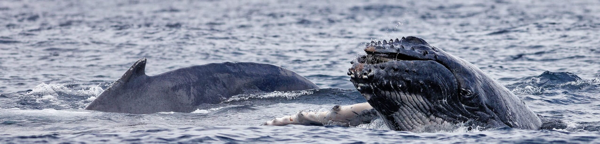

  

Crédit photo : Globice

---

# Salut, moi c'est Matthieu 👋

**Étudiant en développement web, passionné, qui apprend tous les jours.**

> 🔎 **À la recherche d'un stage / d'une alternance** en développement web (Nice et alentours, ou en télétravail).

<!-- Font : Redaction 35 -->

🇬🇧 English version

 

I'm a web development student who loves learning every day, currently looking for an internship or work-study opportunity (Nice area, France, or remote).

I study at Iris Nice (BTS SIO, Software Solutions and Business Applications option), where I learn front-end and back-end web development as well as cybersecurity.

---

## À propos de moi

- Étudiant à **Iris Nice**, en **BTS SIO** (Services informatiques aux organisations), option **SLAM** (Solutions logicielles et applications métiers)
- J'apprends le développement web (front-end et back-end) et la cybersécurité
- Je m'intéresse au **droit des nouvelles technologies** (cybersécurité, protection des données)
- En dehors du code, j'aime les jeux vidéo : rétrogaming, Nintendo, jeux indépendants
- Je suis aussi l'e-sport (League of Legends, CS2) et je pratique des sports et jeux collectifs (JDR, tennis et badminton en double, etc.)

---

## En cours d'apprentissage

  
  
  
  

---

## Ma stack

**Langages**  

**Front-end** (+ DaisyUI)  

**Back-end & bases de données**  

**Outils**  

<!--
============================================================
 SECTION PROJETS (à ajouter plus tard)
============================================================

## 🚀 Projets

### Nom du projet
Une ligne de description. `React` `Node.js` `PostgreSQL`  
[Voir le code](https://github.com/matthieu-debaisieux/nom-du-repo)

-->

---

## Me contacter

<!-- Ajouter ici portfolio / mail si tu en as -->

<!--
============================================================
 STATS GITHUB (à réactiver quand l'activité publique sera plus fournie)
============================================================

  

-->

---

**Merci d'avoir lu ! 🐋**

  

Crédit photo : Globice / Violaine Dulau (baleine à bosse, La Réunion)
