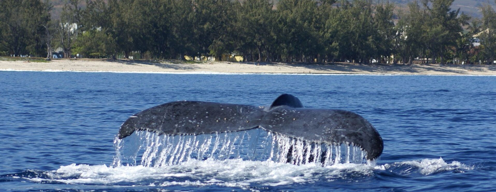

<!-- ============================= -->
<!--          BANNER SECTION       -->
<!-- ============================= -->

  

---

<!-- ============================= -->
<!--          INTRODUCTION         -->
<!-- ============================= -->

# Hi, I'm Matthieu Debaisieux 👋  
# Salut, moi c'est Matthieu Debaisieux 👋

**🇬🇧 A student that loves learning every day!**  
**🇫🇷 Un étudiant passionné qui apprend tous les jours !**

---

<!-- ============================= -->
<!--          ABOUT ME             -->
<!-- ============================= -->

## 🇬🇧 About me / 🇫🇷 À propos de moi

**🇬🇧 English**

- Student at Iris Nice, BTS SIO (Services for Information Technology to Organizations), Software and Business Applications option
- I'm learning web development (front-end and back-end) and cyber security
- Passionate about video games, e-sport, team sports, and law related to new technologies

**🇫🇷 Français**

- Étudiant à Iris Nice, en BTS SIO (service informatique aux organisations) option SLAM (Solution Logiciel et Application Métier)
- J'apprends le développement web (front et back) et la cybersécurité
- Passionné de jeux vidéo, d'e-sport, de sports collectifs et du droit pour les nouvelles technologies

---

<!-- ============================= -->
<!--         TECH & TOOLS          -->
<!-- ============================= -->

## 🇬🇧 Tech & Tools / 🇫🇷 Technologies & Outils

**🇬🇧 Programming languages / 🇫🇷 Langages de programmation**

  
  
  

**🇬🇧 Frontend / 🇫🇷 Front-end**

  
  
  
  
  

**🇬🇧 Backend & Database / 🇫🇷 Back-end & Base de données**

  
  

**🇬🇧 Development environment / 🇫🇷 Environnement de développement**

  
  
  
  

**🇬🇧 Design & collaboration / 🇫🇷 Design & collaboration**

  
  

**🇬🇧 OS & browsers / 🇫🇷 OS & navigateurs**

  
  
  
  
  

---

<!-- ============================= -->
<!--          CONNECT WITH ME      -->
<!-- ============================= -->

## 🇬🇧 Contact / 🇫🇷 Me contacter

  

---

<!-- ========================================== -->
<!--      GITHUB STATS  && VISITOR COUNTER      -->
<!-- ========================================== -->

## 🇬🇧 GitHub Stats / 🇫🇷 Mes stats GitHub

  

  

---

## 🇬🇧 Thanks you for reading ! / 🇫🇷 Merci d'avoir lue ! 

  

<!-- Crédit photo : Globice / Violaine Dulau (baleine à bosse, La Réunion) -->
